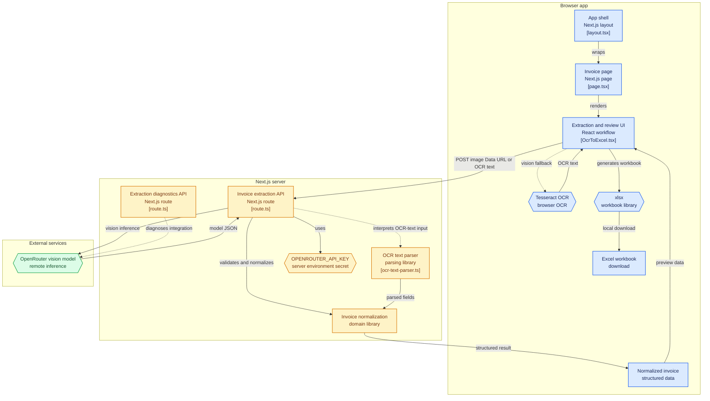

# SnapToSheet 📸→📊

Turn invoice screenshots into Excel in one click.

SnapToSheet is a minimal Next.js app that extracts structured data from invoice images using a vision model (via OpenRouter) with a fast, accurate, and privacy‑respecting flow. It exports a professional multi‑sheet Excel file optimized for accounting workflows.

---

## Overview

- Purpose: Extract invoice fields (vendor, invoice details, line items, totals, taxes, bank details) from images and export a clean Excel workbook.
- Speed: Vision‑first extraction (amazon/nova-2-lite-v1:free via OpenRouter). Tesseract.js is used only as a fallback.
- Output: A 5‑sheet Excel file designed for review, import, and bookkeeping.

---

## Features

- Vision‑first, OCR fallback for robustness
- 5‑sheet Excel export:
   1) Invoice Summary
   2) Line Items
   3) Audit Trail
   4) Accounting Entries
   5) Raw Data
- Totals verification and GST breakdown display
- Clean, single‑page UI with preview and one‑click actions
- Server‑side model calls (API key is never exposed to the browser)

---

## Tech Stack

- Frontend: Next.js 16 (App Router) + React 19 + Tailwind CSS
- Extraction: Google amazon/nova-2-lite-v1:free via OpenRouter (vision‑first) with Tesseract.js fallback
- Export: xlsx
- Runtime/Build: Node.js 18.18+ (or 20+ recommended)

---

## Architecture

- UI Component: [src/components/OcrToExcel.tsx](src/components/OcrToExcel.tsx)
   - Handles file upload/preview
   - Calls the backend to extract structured data
   - Generates a 5‑sheet Excel file with formulas and formatting
- API Route: [src/app/api/extract-invoice/route.ts](src/app/api/extract-invoice/route.ts)
   - Uses OpenRouter with the model `amazon/nova-2-lite-v1:free`
   - Vision‑first flow: sends the image directly to the model
   - Fallback: can accept OCR text when needed
- OCR Fallback: Tesseract.js worker with tuned parameters (LSTM, PSM auto, 300 DPI, spacing preserved)



---

## Project Structure

```
src/
   app/
      api/
         extract-invoice/
            route.ts        # Vision extraction via OpenRouter
      layout.tsx
      page.tsx
   components/
      OcrToExcel.tsx      # Main UI: upload → extract → download
   lib/
      invoice-extractor.ts
      ocr-text-parser.ts
public/
scripts/
   wcag-contrast-check.js
```

---

## Prerequisites

- Node.js 18.18+ (or 20+)
- An OpenRouter API key
   - Create one at https://openrouter.ai/keys
   - Recommended: Review OpenRouter Privacy settings at https://openrouter.ai/settings/privacy

---

## Setup

1) Install dependencies

```bash
npm install
```

2) Configure environment variables

Create a `.env` file in the project root:

```bash
cp .env.example .env  
```

Or create it manually with at least:

```dotenv
OPENROUTER_API_KEY=your_openrouter_key_here
```

Notes:
- The key is only used server‑side in the API route.
- Do not commit `.env` to source control.

3) Run the dev server

```bash
npm run dev
```

Then open http://localhost:3000.

---

## Usage

1) Upload an invoice image (screenshot/photo/scan)
2) Click “Extract Invoice”
3) Review the extracted data in the preview panels
4) Click “Download Excel” to export a 5‑sheet workbook

What you get in the Excel file:
- Invoice Summary: Vendor/Buyer details, amounts, GST breakdown, and verification
- Line Items: Detailed rows with quantities, unit price, taxes, and formulas
- Audit Trail: Extraction context and presence checks per field
- Accounting Entries: Suggested double‑entry lines (debit/credit) with totals
- Raw Data: Flat, CSV‑friendly export for integration

---

## How It Works

1) Client sends the image Data URL to the API route
2) Backend calls OpenRouter with `amazon/nova-2-lite-v1:free` (vision‑first)
3) The model returns a strict JSON structure for invoice fields
4) UI renders a human‑readable preview and allows Excel export
5) If the vision route fails, the UI can fall back to Tesseract OCR

Key files:
- Vision/API flow: [src/app/api/extract-invoice/route.ts](src/app/api/extract-invoice/route.ts)
- UI and Excel export: [src/components/OcrToExcel.tsx](src/components/OcrToExcel.tsx)

---

## Configuration

- Default Model: `amazon/nova-2-lite-v1:free` (supports system prompts and vision)
- Excel Formatting: Numeric cells formatted with `#,##0.00` where appropriate, formulas for totals
- GST Handling: Displays IGST/CGST/SGST rates and amounts when present
- Totals Check: Compares computed total vs extracted total and flags mismatches

---

## Scripts

```bash
npm run dev     # Start the dev server
npm run build   # Production build
npm run start   # Start the production server
npm run lint    # Run eslint
```

---

## Deployment

- Vercel is recommended for Next.js
- Add `OPENROUTER_API_KEY` to your project’s environment variables
- Build command: `npm run build`
- Start command (if not auto‑detected): `npm run start`

---

## Troubleshooting

- Model/Policy errors:
   - Ensure the OpenRouter key is valid and has quota
   - Check OpenRouter privacy settings (must allow the selected model)
   - The app attempts to provide clear error messages in the UI
- Slow extraction:
   - Vision path is fastest. Very large images or slow networks can still affect duration
   - As fallback, Tesseract.js will be slower than the vision route
- Empty/Incorrect fields:
   - Try a clearer screenshot or a higher‑resolution scan
   - Cropped edges or poor lighting can reduce accuracy

---

## Roadmap

- Drag‑and‑drop upload zone
- Optional image pre‑processing (deskew/denoise) for OCR fallback
- Model selector (fast vs high‑accuracy)
- Basic field correction UI before export

---

## Security & Privacy

- No login; no persistent history on the server
- The API key is server‑side only; never exposed to clients
- Be mindful of your model provider’s privacy settings and data retention

---

## Acknowledgements

- OpenRouter for model access
- Tesseract.js for OCR fallback
- The Next.js and Tailwind CSS communities
